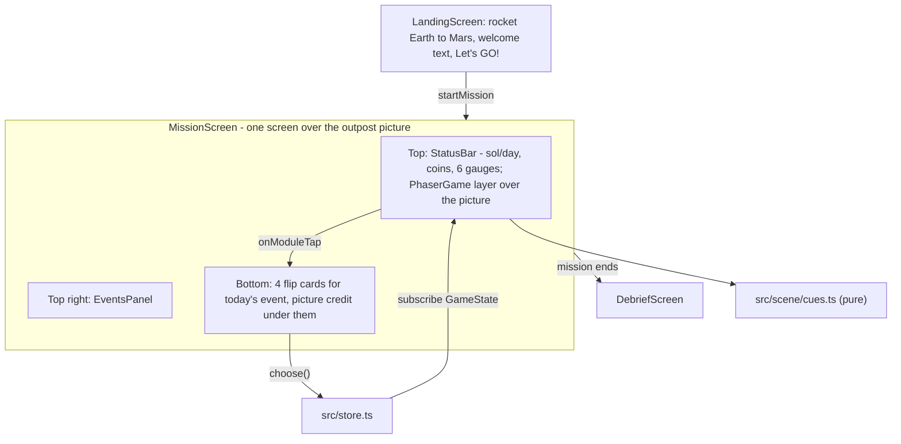
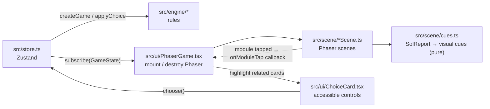
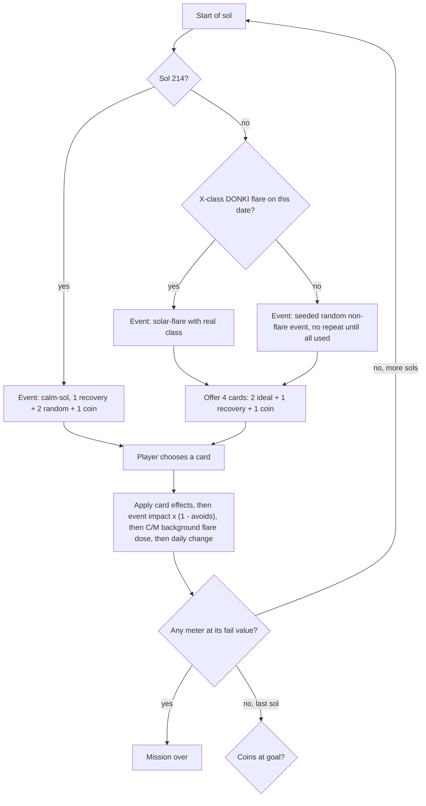

# Martian Odyssey: phased plan

**Source of truth** for the phased plan and next steps. `docs/roadmap-2d.md` only points here. The single checklist for all remaining work on **Martian Odyssey**, a 2D Mars outpost game for the [Junior Astronaut Mission Trainer challenge](https://www.spaceappschallenge.org/2026/challenges/junior-astronaut-mission-trainer/). It merges the 2D scene roadmap (Phases 0-6) with the new layout (landing page and three-row mission screen) and the new game content (six meters, events, 16 sols). Decision record: `docs/decisions.md`. Architecture: `docs/system-design.md`. Rules and tables: `docs/game-design.md`.

## Rules for using this checklist

- Every step has an id (`P1.4`), an action and a **Check**. Tick `[x]` only when the Check passes, and add the date (and commit or PR if there is one).
- A phase starts only after the previous phase's **exit gate** passes. Phases 0-2 are the minimum submission.
- Never delete a step. A dropped step stays unticked with `(dropped YYYY-MM-DD: reason)`. New steps get the next free number in their phase. Steps are listed in the order they are done, so ids are not always in number order.
- Every phase ends with `npm run check`, plus `npm run sim` if tuning changed, `npm run test:e2e`, `npm run build`, and a browser check at desktop and 375 px.
- Update the progress table whenever you tick a step.

## Progress

| Phase | Steps done | Status |
| ----- | ---------- | ------ |
| Step 0 - Single source of truth (docs) | 2 / 2 | Done 2026-11-15 |
| 0 - Baseline, rules, content and rename | 17 / 17 | Done 2026-11-15 |
| 1 - Bridge, landing page and layout | 13 / 14 | Exit gate passed 2026-11-15; P1.14 (feedback round) open |
| 2 - Cues: making trade-offs visible | 5 / 9 (P2.4 dropped) | In progress: P2.6, P2.7, P2.9 need the browser check; P2.8 needs a playtest |
| 3 - Interaction and accessibility | 0 / 7 (P3.1 optional) | Not started |
| 4 - Art and real imagery | 1 / 10 (P4.4 = P1.12; P4.5 rescoped) | Not started |
| 5 - Debrief and data depth | 0 / 6 | Not started |
| 6 - Playtest and ship | 0 / 10 | Not started |

## Game identity

- **Title:** Martian Odyssey. The outpost inside the story is "Martian Outpost Odyssey".
- **Challenge name stays separate:** "Junior Astronaut Mission Trainer" is the NASA Space Apps challenge, not the game's name. On the project page and in the README use "Martian Odyssey - a Junior Astronaut Mission Trainer for NASA Space Apps 2026". `docs/challenge-brief.md` keeps the challenge name unchanged.
- The Phaser game config (`src/scene/config.ts`, Phase 1) uses `title: 'Martian Odyssey'`; sharing assets (`og-image`, `app-icon`, demo video) show the title (Phase 6).

## Guiding principles

1. **The scene is a view, not a rule system.** All rules stay in `src/engine/`. Phaser renders `GameState` and the latest `SolReport`; it never changes meters or coins itself.
2. **Turn-based stays.** One event and one decision per sol. Animation shows the consequence; it does not replace the decision.
3. **Every animation is backed by engine output.** Events come from `state.event`; numbers come from `SolReport` (`before`, `after`, `impactApplied`, `avoidedImpact`).
4. **Cards remain the accessible way to play.** The canvas is an enhancement; keyboard, screen-reader and Playwright play keep working through the card buttons.
5. **Mechanics before polish.** Placeholder shapes are fine until Phase 4. The only exception is the outpost picture (P1.12, replaced by NASA's artist's concept in P1.13).
6. **Honest data.** Units are real, but amounts are **game numbers** unless marked REAL. The REAL items are the 0.67 mSv per sol Mars baseline and the DONKI flare dates and classes. The Data Sources screen and the dial tooltips say so.

## Game decisions (2026-11-15)

Full reasoning in `docs/decisions.md`; live values in code.

- **16 sols**, displayed as Sol 215-230 (`displaySol(sol) = sol + 214`, display only). Science is shown as **Coins**; goal 100.
- **Six meters in real units** (`METERS` in `src/engine/config.ts`): power (kWh), oxygen (kg), water (kL) and food (kg) fail at 0; radiation dose (mSv) fails at 40 and waste (kg) at 300. Each has a warning level and a kid-friendly tooltip (`src/ui/labels.ts`).
- **Crew of 10 astronauts** (story text on the landing page; meter amounts are game numbers).
- **Start values** (2026-11-15 feedback): power 80 kWh, oxygen 250 kg, water 7 kL, food 10 kg, radiation 3 mSv, waste 40 kg. Food was retuned to fit (warning 4 kg, daily -1, max 40) and oxygen daily is -9; see `docs/decisions.md`.
- **Event-first sols** (`pickEvent`): Sol 215 is calm; a real DONKI flare **above X3** gives Solar Flare Warning (with the bundled data: Sol 219, 220, 223, 224); otherwise one of 8 seeded random events with no repeats. Weaker flares add a background dose (C 0.1, M 0.5, X 1 mSv).
- **Four cards** (`offerChoiceIds`): the event's 2 response cards, 1 recovery card for the meter with the least room before its warning level, 1 coin card.
- **Event impact with avoids:** each event has an impact; response cards prevent all, half or none of it and have their own costs.
- **Content:** 14 regular cards (`src/engine/choices.ts`, including "Melt trash into tiles"), 10 events and 18 response cards (`src/engine/events.ts`). Coin rewards were raised about 1.5x so 100 is reachable. Tables in `docs/game-design.md`; the original draft tables are in the appendix.
- **Card flip:** tapping a card flips it to its lesson ("Did you know?"); the choice is applied only when the player taps **Next sol** (or **Finish mission**), so the lesson is always read first.
- **Rendering:** the outpost picture is an HTML image (a painting, NASA PIA23302); Phaser is a transparent layer over it; Framer Motion animates the landing page, gauges, coins and the card flip. Because the base is a painting, scene cues are **overlay effects anchored to landmarks in the picture**, not drawn modules or walking crew.

## Screens



- **Landing page:** real NASA photos - a Milky Way star field taken by the Artemis II crew, Earth by Apollo 17 and Mars by Mars Global Surveyor - put together by the game (captioned "not to scale"), and a Framer Motion rocket flying from Earth to Mars in about 4 s. Then the welcome text and a **Let's GO!** button fade in. There is a Skip button, and reduced motion jumps straight to the end state. Subtitle: "NASA Space Apps: Junior Astronaut Trainer". Text: "Welcome to Mars! It is Sol 215. You are the captain of the Martian Outpost "Odyssey". Keep your crew of 10 astronauts safe. Watch the power, oxygen, water, food, radiation, and waste capacity. Earn coins before Sol 230 to complete your mission successfully."
- **One screen (`md` and up, no scrolling):** NASA's artist's concept PIA23302 fills the screen; its caption ("a drawing, not a photo") is one subtle line at the bottom right, under the cards. On top of it, `StatusBar` (the only place meters appear):
  - **`ResourceGauge` x6:** icon, value with unit and a segmented fill bar with a striped danger zone (bold red with a white marker for power, oxygen, water and food), a "Danger under/over X" label, `role="meter"`, ⚠️ plus "Low!" / "Too high!" at the warning level. The kid-friendly explanation appears on **hover, keyboard focus and tap**, linked with `aria-describedby`, and notes "game number" except for the REAL radiation baseline. Phones: one compact row at the bottom of the picture; `md` and up: a row with names at the top.
  - **`CoinCounter`:** a pile of SVG gold coins that grows to the goal, plus coins / goal. **`SolCounter`:** "Sol 215", the real date and "📅 Day: 1 of 16". The coins tile is titled "Coins from Science".
  - Under them, `PhaserGame` and `BaseScene`: a transparent layer with tap areas over the picture, where Phase 2 cues will play.
- **Top right, `EventsPanel`:** today's event (icon, title, description, and for flares the real class, date and NASA DONKI label), yesterday's result, `RealDataBadge`, a Data Sources link, and an `aria-live` region.
- **Bottom:** the heading "What should the crew do today?" (a yellow pill), then today's 4 `ChoiceCard`s. Each flips to its lesson with a Next sol button. Response cards carry a "Handles: ..." tag in text and an icon, never colour alone. Effect chips show units. `MissionLog` is collapsed.

Built in Phase 1 (redesigned in P1.13): `LandingScreen`, `StatusBar` (with `ResourceGauge`, `CoinCounter`, `SolCounter`), `EventsPanel`, `PhaserGame` and `MissionScreen`.

## Scene modules and animations

- **Landmarks, not drawn modules:** the scene is a transparent layer over a painting, so each meter maps to a tap area and an anchor point on a landmark in the picture (habitat, rover, open ground, sky). The original module list stays as the mapping guide: power (solar panels that can fold, battery), oxygen (generator with bubbles), water (tank fill level), food (greenhouse, plants grow or wilt), radiation (storm shelter and crew dosimeter badges), waste (squasher and pile), coins (lab and antenna), plus the rover, the ice drill and the repair bots.
- **Card animations:** the `animation` field of every card in `choices.ts` and `events.ts`.
- **Event animations, at the start of the sol:** flare (the sky flashes and the real label shows), dust storm (a dust wall rolls in), greenhouse (plants wilt), pipe leak (drips), dry-ice storm (snow falls), rover in a trap (the rover sinks), drill hits bedrock (the drill sparks), crack in the dome (a crack and an air hiss), discovery (the lab sparkles).

## Assets

Full manifest with sources, licences and status: `docs/assets.md`.

- **Phases 0-3 are drawn in code, except real NASA pictures:** the landing page uses NASA photos (P1.13 follow-up) with a Framer Motion rocket; gauges and coins in SVG and CSS; crew and effects with Phaser Graphics, tweens and particles. The only files are `bg-outpost` (NASA's artist's concept PIA23302, P1.13) and `fx-particle`.
- **Phase 4 adds effect art only:** the painting replaces modules, crew, rover and drill sprites, and real photos replace the landing planets. Phase 4 packs the event effects (dust, snow, sparks, crack, drips, flash, bubbles) into one atlas; SVG icons are optional.
- **Rules:** public domain, CC0 or OFL only; about 3 MB total; a `docs/assets.md` row before every file; credit in-game; no NASA logo; nothing edited to look like a real photo of something that didn't happen.

## Architecture and lint



- `src/scene/cues.ts`: pure `cuesForSol(report, state)` with no Phaser import, unit-tested.
- `src/scene/BaseScene.ts`: draws and plays cues; may import engine types and read-only helpers; never calls `applyChoice` or `createGame`.
- `src/scene/config.ts`: Phaser config, layout and asset keys - visual tuning only, no game-balance numbers.
- `src/ui/PhaserGame.tsx`: lazy `import()`, exactly one canvas, `useGameStore.subscribe`, and the `onModuleTap` callback. Details: `.cursor/skills/phaser-react-bridge/SKILL.md`.
- `eslint.config.js`: `phaser` is banned in `src/engine/**`; `react`, `src/ui` and `src/store` are banned in `src/scene/**`.

## Step 0 - Make this the single source of truth (docs only)

- [x] **S0.1** Write the combined plan into `docs/roadmap-2d.md`, keeping the ticks for P0.1-P0.3; add the `docs/decisions.md` entries; update `AGENTS.md` rule 2 and `docs/game-design.md` (including the "where we simplify" note for sols vs Earth dates). **Check:** this file lists every step id below, and `AGENTS.md` rule 2 names the six meters. _(2026-11-15)_
- [x] **S0.2** Update `docs/assets.md` for the redesign (Kenney CC0 + original art): oxygen and radiation wording; landing page, `mod-waste`, `prop-repair-bot`, new module states, event effects, `ui-dial`, `icon-coin`, `icon-event-*` (10), `icon-choice-*` (31) and event sounds. **Check:** every asset named in this plan has a row with an id, phase, source, licence and status; `rg -i "\b(air|shielding)\b" docs/assets.md` shows nothing outdated. _(2026-11-15)_

## Phase 0 - Baseline, rules, content and rename

- [x] **P0.1** Green baseline. **Check:** `npm run check` passes (53 tests). _(2026-11-15)_
- [x] **P0.2** Mars-only. **Check:** `rg -i moon src` returns nothing; `docs/decisions.md` has the entry. _(2026-11-15)_
- [x] **P0.3** Baseline balance recorded for the old 12-day game (balanced 99.5%, random 14.2%, science-rush 0.0%). _(2026-11-15)_
- [x] **P0.11** 16-sol mission: `maxSols: 16`, with the docs, `README.md` and `AGENTS.md` updated. **Check:** `rg "12 days|12 sols"` shows nothing outdated, and `npm run check` passes. _(2026-11-15)_
- [x] **P0.12** Display labels: `displaySol()` (offset 213) and science shown as Coins 🪙 across the UI and debrief. **Check:** `displaySol(1) === 214` and `displaySol(16) === 229` (`src/ui/labels.test.ts`). _(2026-11-15)_
- [x] **P0.13** Six meters in real units with per-meter `start`, `max`, `daily`, `warnAt`, `failAt` and `direction`; shielding, `shieldingBlockFraction`, `FLARE_SHIELDING_DAMAGE` and `powerUpkeepModifier` removed; per-meter loss reasons and `LOSS_MESSAGES`. **Check:** unit tests cover each meter's fail value and warning level; `npm run check` passes. _(2026-11-15)_
- [x] **P0.14** `src/engine/choices.ts` holds the 13 regular cards. The compact-trash lesson no longer cites an unverified source. **Check:** `design-rules.test.ts` passes for the regular pool. _(2026-11-15)_
- [x] **P0.15** `src/engine/events.ts` with the 10 events (impact, ideal cards with avoids, trigger) and the 18 response cards. **Check:** tests show every event except calm-sol has exactly 2 ideal cards that exist and belong to it, every response card belongs to one event, and no event impact uses coins. _(2026-11-15)_
- [x] **P0.16** Event-first sol flow in `engine.ts` (calm Sol 214, X-class flare event, seeded random events without repeats, 2 + 1 + 1 cards, room-before-warning recovery, no send-data-home on discovery sols, resolution order). **Check:** unit tests for each of these, the avoids math and determinism pass. _(2026-11-15)_
- [x] **P0.17** `design-rules.test.ts` extended without weakening it (response cards: own cost, avoided impact counts as gain, no domination between siblings; six-meter cap). **Check:** temporarily removing Dig up ice's gain made two tests fail; restored. _(2026-11-15)_
- [x] **P0.4** `index.html` title and meta description say "Martian Odyssey". **Check:** the browser tab reads "Martian Odyssey". _(2026-11-15)_
- [x] **P0.5** The start-screen heading is "Martian Odyssey". **Check:** desktop and 375 px screenshots. _(2026-11-15)_
- [x] **P0.6** The Playwright heading check matches `/Martian Odyssey/` and checks Sol 214 and the event panel. **Check:** `npm run test:e2e` passes. _(2026-11-15)_
- [x] **P0.7** `README.md` and `AGENTS.md` headings renamed, `package.json` `name: martian-odyssey`, lockfile refreshed. **Check:** `rg "Junior Astronaut Mission Trainer" -g '!docs/challenge-brief.md'` only shows challenge links or the subtitle. _(2026-11-15)_
- [x] **P0.8** Nunito self-hosted (`@fontsource/nunito`, weights 400/700/800/900). **Check:** `document.fonts` shows Nunito loaded with no external font requests; `docs/assets.md` says `done`. _(2026-11-15)_
- [x] **P0.9** `npm run data:fetch -- 2024-05-06 2024-05-21`. **Check:** the snapshot has `source: "donki"`, `verified: true` and covers 16 sols (126 flares: 15 X, 108 M, 3 C); `docs/data-sources.md` is updated. Fetched from `ccmc.gsfc.nasa.gov` because `api.nasa.gov/DONKI/FLR` returns 404. _(2026-11-15)_
- [x] **P0.10** `scripts/simulate.ts` updated for event-first sols; retuned one lever at a time (oxygen daily, water daily, coin goal, waste start). **Check:** `npm run sim` shows balanced 76.1%, random 2.1%, coin-rush 0.0%; the table is in `docs/game-design.md` and the levers are in `docs/decisions.md`. _(2026-11-15)_
- [x] **Exit gate:** `npm run check` (134 tests), `npm run test:e2e` and `npm run build` pass; the tab and heading say "Martian Odyssey". _(2026-11-15)_

## Phase 1 - Bridge, landing page and three-row layout

- [x] **P1.1** `npm install phaser`. **Check:** `package.json` lists `phaser ^3.90.0` (installed 3.90.0). _(2026-11-15)_
- [x] **P1.2** Lint rules. **Check:** a temporary `import Phaser from 'phaser'` in the engine, and `import React` plus `import { applyChoice } from '../engine'` in the scene, all failed `npm run lint`; probes removed. _(2026-11-15)_
- [x] **P1.3** `src/scene/config.ts` (`title: 'Martian Odyssey'`, 960x540 design size, `Scale.FIT`, module layout, texture keys). **Check:** `npm run typecheck` passes. _(2026-11-15)_
- [x] **P1.4** `BaseScene` with labelled placeholder modules for the six meters, coins, the rover and the drill, plus 3 idle crew shapes. **Check:** desktop screenshot shows every module labelled with its value and unit (and ⚠️ at the warning level). _(2026-11-15)_
- [x] **P1.5** A lazy `PhaserGame.tsx` in the middle row. **Check:** Playwright (production build) sees no `scene-*.js` request on the landing page and exactly one after Enter; after a full mission and "Try another mission", the page has one canvas. _(2026-11-15)_
- [x] **P1.6** Store updates reach the scene. **Check:** Playwright compares the scene snapshot with every dial's `aria-valuenow` for 3 sols. _(2026-11-15)_
- [x] **P1.7** Bundle size. Before Phaser: main JS 414 kB (133 kB gzip). After: main JS 423 kB (136 kB gzip), lazy Phaser + scene chunk 1,200 kB (321 kB gzip), `bg-mars.webp` 270 kB. _(2026-11-15)_
- [x] **P1.8** Smoke test: Skip, Enter, then the canvas is visible, an event shows, `sceneReady`, no console errors, and the mission completes via the cards. **Check:** `npm run test:e2e` passes (5 tests). _(2026-11-15)_
- [x] **P1.9** `?seed=N` replay (`src/store.ts`) and the read-only `?e2e` hook `window.__MARTIAN_ODYSSEY__` (`src/ui/testHook.ts`: `sceneReady`, `sol`, `eventId`, `modules`, `canvasCount`; frozen, no setters). **Check:** Playwright plays `?seed=1` twice and gets identical events and cards on Sol 214-216. _(2026-11-15)_
- [x] **P1.10** `LandingScreen.tsx` (star field, Earth, Mars, distant planets, 4 s rocket flight, Skip, reduced motion jumps to the end, welcome text, Enter). **Check:** no Phaser chunk on this page (P1.5 test); screenshots at desktop and 375 px; Enter leads to "Sol 214". _(2026-11-15)_
- [x] **P1.11** Three-row `MissionScreen`: `StatusBar` (6 `ResourceDial`s with units, hatched warning bands, "⚠️ Low!" / "⚠️ Too high!" and tooltips, `CoinCounter`, `SolCounter`, `EventsPanel` with the real flare label and yesterday's result), then `PhaserGame`, then the 4 cards with "Handles: ..." tags. **Check:** Playwright matches dials and scene for 3 sols and opens a tooltip on hover, focus and tap; browser check of Sol 214-216 (calm, dust storm, real X1.0 flare); screenshots at desktop and 375 px with no horizontal scroll. At 375 px the scene's labels are small and the cards start below the first screen - handled in P3.5. _(2026-11-15)_
- [x] **P1.12** (= P4.4, moved earlier) Real Mars background: Curiosity Mastcam PIA16101 (Mount Sharp, Gale Crater), centre crop, 270 kB WebP. **Check:** credit under the scene and on the Data Sources screen (`src/data/sources.ts`), `docs/data-sources.md` and `docs/assets.md` rows, `public/assets` is 272 kB, no NASA logo. _(2026-11-15)_
- [x] **P1.13** UI feedback redesign (supersedes the look from P1.4, P1.11 and P1.12; see `docs/decisions.md`): a full-width NASA artist's concept of a Mars base (PIA23302, captioned "a drawing, not a photo"), with the sol, coins and six meters on top of it and nowhere else. `ResourceGauge` (segmented fill bar, striped danger zone, ⚠️ text) replaces `ResourceDial`; coins are SVG gold coins; the scene is a transparent layer with tap areas only. **Check:** `npm run check` (135 tests), `npm run test:e2e` (5 tests, now using `meter-*` test ids) and `npm run build` pass; browser check at 1280x800 and 375x812 with `scrollWidth` 375 and tooltips inside the screen; `public/assets` is 204 KB. _(2026-11-15)_
- [x] **Exit gate:** a full mission is playable from the landing page to the debrief; `npm run check` (135 tests), `npm run test:e2e` (5 tests) and `npm run build` pass. _(2026-11-15)_
- [ ] **P1.14** Feedback round after the exit gate (2026-11-15): landing subtitle and "crew of 10" text; Day counter with calendar; "Coins from Science"; picture credit moved under the cards; new start values and retune (food warning 4, daily -1, max 40; oxygen daily -9; coins about 1.5x); bolder danger zones and "Danger under/over" labels on all six gauges; new welcome text; DONKI badge shortened; bigger crew-question heading; card flip with lesson and Next sol; "Melt trash into tiles" card; flare event only above X3. Done so far: `npm run check` (138 tests) and `npm run sim` (balanced 81.2%, random 4.1%, coin-rush 0.0%). **Check:** `npm run test:e2e` (updated to flip and continue) and `npm run build` pass; browser check at 1280x800 with no scrolling and at 375 px, including a flipped card.

## Phase 2 - Cues: making trade-offs visible

- [x] **P2.1** The `SceneCue` type in `cues.ts`, with no Phaser import. **Check:** `rg phaser src/scene/cues.ts` returns nothing. The module layout moved to the Phaser-free `src/scene/layout.ts` so cues and tests can use it. _(2026-11-15)_
- [x] **P2.2** Map every regular and response card (32) to a module landmark in the picture. **Check:** a unit test fails if any card is unmapped. `CARD_MODULES` in `cues.ts`; `cues.test.ts` checks all 32. _(2026-11-15)_
- [x] **P2.3** `cuesForSol` for `event-start`, `resource-delta`, `crew-outside` and `impact-avoided`. The choice is applied after the card flip, so the last sol's `resource-delta` and `impact-avoided` cues play **before** the new sol's `event-start`. **Check:** unit tests for each cue and the order, a flare sol and a random-event sol. 13 tests in `src/scene/cues.test.ts`; played by `src/scene/CuePlayer.ts` (about 2.5 s per sol, cancelled when a new sol arrives). `src/scene/**/*.test.ts` may import `applyChoice`/`createGame` to get real reports (lint exemption for tests only). _(2026-11-15)_
- [ ] **P2.4** `shield-absorb` uses `shieldingBlockFraction`. _(dropped 2026-11-15: the shielding resource was replaced by the radiation dose; see P2.10)_
- [x] **P2.5** Floating deltas with units, for example "+20 kWh ⚡ −5 kg 💨". **Check:** for 3 sols, they match the `MissionLog` before and after values. Unit test over 4 sols compares every delta with `SolReport.before`/`after` (what `MissionLog` shows); text always has a sign, unit and icon. Visual check in the browser still to do with P2.9. _(2026-11-15)_
- [ ] **P2.6** A "crew outside 🧑‍🚀" marker at the card's landmark for cards that add radiation (rescoped 2026-11-15: walking crew sprites would clash with the painted astronauts). **Check:** "Clean the solar panels" shows the marker; "Recycle the water" does not. Cue unit-tested; the browser check is open.
- [ ] **P2.7** Flare cue with the real class and date. A weaker background flare gets a light flash and its label only. **Check:** on the first flare-event sol (Sol 219, X3.9) the flash and label appear; on Sol 217 (X1.0 background) only the light flash; on a quiet random-event sol nothing. Cues unit-tested against the real snapshot (Sol 219 X3.9 event, Sol 217 X1.0 background); the browser check is open.
- [ ] **P2.9** A full-scene overlay effect for each of the 9 non-calm events at the start of the sol (crew reaction dropped 2026-11-15: no crew sprites over the painting). **Check:** a unit test shows each event produces its cue; a screenshot of each event using `?seed`.
- [x] **P2.10** An `impact-avoided` cue shows how much of the event was stopped, for example "Saved 0.75 kL 💧". **Check:** a unit test asserts it equals `SolReport.avoidedImpact`. _(2026-11-15)_
- [ ] **P2.8** Scene-only playtest. **Check:** with the effect chips hidden, a tester names the main cost of 3 out of 3 choices from the scene alone; notes in decisions.
- [ ] **Exit gate:** `npm run check` passes with the cue tests. This is the minimum submission; tag the commit here.

## Phase 3 - Interaction and accessibility

- [ ] **P3.1** _(optional since 2026-11-15: the picture's landmarks do not map cleanly to the six meters; consider tapping a meter tile instead)_ Tapping a module highlights the cards that affect it, with an outline plus "Affects water" text. **Check:** tapping the water tank highlights exactly the offered cards that have a water effect.
- [ ] **P3.2** The canvas is `aria-hidden`; the `EventsPanel` live region narrates the event and its result. **Check:** the accessibility snapshot has no canvas content, and VoiceOver reads the narration.
- [ ] **P3.3** Reduced motion covers the landing page, the card flip and the scene. **Check:** with it emulated, no tweens play and the end states still show.
- [ ] **P3.4** Keyboard-only play, including the gauge tooltips and the card flip (focus moves to Next sol). **Check:** the full mission works with Tab, Enter and Space, with a visible focus ring.
- [ ] **P3.5** Responsive one-screen layout (cards over the picture on `md` and up; picture, then event and cards on phones). **Check:** screenshots at 375x812 and 1280x800; `scrollWidth <= 375`.
- [ ] **P3.6** Touch targets of at least 48 px, including the gauges and the Next sol button. **Check:** the bounding boxes.
- [ ] **P3.7** Colour is never the only signal. **Check:** a greyscale screenshot still shows the warnings (icon and text), the danger zones and labels, gains versus costs, and the "Handles" tags.
- [ ] **Exit gate:** check and e2e pass; P3.2-P3.4 notes written here.

## Phase 4 - Art and real imagery

- [ ] **P4.1** A `docs/assets.md` row before any file is added. **Check:** every asset has a row and a licence.
- [ ] **P4.2** The wordmark on the landing page. **Check:** the accessible name is still "Martian Odyssey".
- [ ] **P4.3** Favicon. **Check:** the tab shows it.
- [x] **P4.4** Real Mars background. _Done early as P1.12._ _(2026-11-15)_
- [ ] **P4.5** Effects atlas: the overlay effects for the 9 events (dust wall, snow, crack, drips, sand, sparks, sparkle, flash, bubbles) and, optionally, the landing rocket (rescoped 2026-11-15: the painting replaces module, crew, rover, drill and bot sprites; NASA photos replace the landing planets). **Check:** assets rows say `done`; screenshot of a full sol.
- [ ] **P4.6** _(optional since 2026-11-15: the emoji icons work and every icon has a text label)_ SVG icons for the meters, coins, cards and events. **Check:** they look the same in Chrome and Safari, and each has a text label.
- [ ] **P4.7** "Art and sound credits" on the Data Sources screen. **Check:** every non-NASA asset is listed.
- [ ] **P4.8** Asset budget. **Check:** `du -sh public/assets` is 3 MB or less.
- [ ] **P4.9** No NASA logo. **Check:** visual review, noted here.
- [ ] **P4.10** Optional "Cadet" mode. **Check:** a decisions entry records whether it shipped or was dropped.
- [ ] **Exit gate:** every image is credited in-game; check, e2e and build pass.

## Phase 5 - Debrief and data depth

- [ ] **P5.1** Debrief timeline of Sol 215-230 showing each sol's event, with real flares marked as REAL and labelled as the flare event (above X3) or background only. **Check:** the flare sols match `space-weather.json`.
- [ ] **P5.2** Radiation added per sol on the timeline. **Check:** the values match `SolReport.doseMsv`.
- [ ] **P5.3** RadLab ISS comparison. **Check:** the data file records the instrument, dates and units; the sources docs are updated.
- [ ] **P5.4** Verify the facts and lessons, including the new card and event lessons and "Melt trash into tiles". Higher priority since the card flip shows every lesson; can be done before Phase 5. **Check:** `verified: true` only where the source was checked.
- [ ] **P5.5** Verify the Mars baseline of 0.67 mSv per sol. **Check:** the TODO in `docs/data-sources.md` is replaced with a page or figure reference.
- [ ] **P5.6** Optional OSDR study snapshot. **Check:** 3-5 studies with IDs.
- [ ] **Exit gate:** the debrief shows the loss reason, the lessons, coins earned, and at least one verified real number.

## Phase 6 - Playtest and ship

- [ ] **P6.1** Playtest with 3-5 children aged 7-12. Also watch whether they read the flipped lesson, whether the extra Next sol tap annoys them, and whether starting with 10 kg of food feels too stressful. **Check:** at least 3 can explain one real trade-off.
- [ ] **P6.2** Fix the top issues. **Check:** each is listed as fixed or deferred.
- [ ] **P6.3** Low-end performance. **Check:** with 4x CPU throttling, an event sol stays at 30 fps or more.
- [ ] **P6.4** Audio is off by default with a mute button. **Check:** first load is silent.
- [ ] **P6.5** Final gates. **Check:** check, sim, e2e and build all pass.
- [ ] **P6.6** Deploy. **Check:** the public URL works on a phone and a desktop. Decide first whether the `VITE_NASA_API_KEY` key may be public (Vite embeds it in the build).
- [ ] **P6.7** `og-image` and app icon. **Check:** the link preview shows.
- [ ] **P6.8** Demo video: the landing, one event with its trade-off, and one real flare. **Check:** linked here and from the README.
- [ ] **P6.9** Project page and README: what is REAL, CURATED and GAME (including "real units, game amounts"). **Check:** every source in `src/data/sources.ts` appears.
- [ ] **P6.10** Submit. **Check:** the confirmation is written here.
- [ ] **Exit gate:** submitted.

## Testing strategy

- **Engine:** the meter fail rules, the event picker (DONKI vs random, seeded, no repeats), the card offer (2 + 1 + 1), the avoids math, and the extended `design-rules.test.ts` (never weakened).
- **Labels:** `displaySol`, the Coins label, and the units.
- **Cues:** Vitest on the pure `cues.ts`, covering every event.
- **Scene and screens:** Playwright: landing, Let's GO!, Sol 215, an event shown, one canvas, no console errors, and the mission completes by flipping each card and tapping Next sol. Phaser is not unit-tested in jsdom.
- **Balance:** `npm run sim` with event-first sols after any tuning; the scene never affects results.

## Risks

- **DONKI unreachable:** stop and ask; never invent flare days. `api.nasa.gov/DONKI/FLR` already returns 404, so the CCMC endpoint is tried first.
- **Real units read as real data:** the tooltips and the Data Sources screen say "game numbers in real units"; only the REAL items are tagged REAL.
- **Waste and radiation feel unimportant:** after the 2026-11-15 retune they almost never end a mission (oxygen and food carry the pressure); raise waste daily or the flare dose if playtests show it.
- **Every sol has an event, which may overwhelm young players:** Sol 215 is calm; watch for it in the P6.1 playtest.
- **Polish crowds out mechanics:** Phases 0-2 are the minimum submission.
- **Phaser bundle size:** lazy-loaded; the landing page has no Phaser.
- **The canvas excludes some players:** the cards stay primary, and the events panel narrates.
- **React and Phaser fight over state:** one direction only - store to scene; the scene only calls the `onModuleTap` callback.

## Appendix: original content draft (superseded)

Kept for history. These were the draft tables reviewed before building started; live values are in `src/engine/` and `docs/game-design.md`, which win if anything here disagrees.

### Original content draft (2026-11-15)

`*` marks a value I changed from your tables. The reasons are listed under each block. Everything except the REAL items is a game number and gets retuned in P0.10.

#### Resources (meters)

```csv
key,name (kids),icon,unit,start,dial max,daily change,warning at,fails at,better when,real or game,kid friendly explanation (dial tooltip)
power,Power,⚡,kWh*,80,100,-3,<=45,<=0,higher,game,Electricity from solar arrays & nuclear batteries.
oxygen,Oxygen,💨,kg,220,300,-10,<=60,<=0,higher,game,Breathable air inside the dome.
water,Water,💧,kL*,5*,8,-0.35*,<=1.5,<=0,higher,game,"Drinking, washing, and growing plants."
food,Food,🍽️,kg,90*,200,-4*,<=35,<=0,higher,game,Freeze-dried astronaut meals & greenhouse crops.
radiation*,Radiation dose*,☢️,mSv*,0*,40*,+0.67*,>=30,>=40,lower,REAL daily baseline (Curiosity RAD); budget is game,Space radiation the crew has soaked up. Lower is safer!*
waste,Waste,💩,kg,100*,300*,+10*,>=240,>=300,lower,game,Trash & leftover biomass waiting to be squashed.
```

Changes:

- **Power unit kW to kWh:** stored energy is measured in kWh.
- **"kl" to kL.**
- **Radiation:** the key and name change from "shielding / Radiation Shielding" because it tracks a dose. It starts at 0 instead of 140, which was already over the fail value. The unit becomes mSv (a running total), not mSv/year, and it goes up by +0.67 per sol, the real per-day value.
- **Waste:** it goes up by +10 per sol because the crew makes trash, and the dial maximum is the fail value. It starts at 100 instead of 190, so the dial doesn't start just below the warning level (review fix 2).
- **Water and food:** water starts at 5 kL and falls 0.35 kL per sol; food starts at 90 kg and falls 4 kg per sol. Over 16 sols each would cross its warning level without help, so water and food cards matter (review fix 3).
- **Mars dust power penalty** (`powerUpkeepModifier -2`) is removed, because your daily -3 already covers power.

#### Settings

```csv
setting,value,real or game
Mission length,16 sols (Sol 214-229),game
Cards per sol,2 ideal for the event + 1 recovery + 1 coin,game
Cards on Sol 214 (calm welcome sol),1 recovery + 2 random regular + 1 coin,game
Coins start,0,game
Coins goal,120 (draft - set by the P0.10 retune),game
Flare event trigger,X-class flare on that date only,game rule (flare dates and classes are REAL from DONKI)
Solar-flare event impact (X class),radiation +4 mSv,game
Background flares (C / M class),"radiation +0.1 / +0.5 mSv, unavoidable, one line in the events panel; the sol still gets a random event",game (flare dates and classes are REAL)
Daily radiation baseline,+0.67 mSv per sol,REAL (Hassler et al. 2014)
Random events,seeded; Sol 215 onward; no repeat until all 8 non-flare events are used,game
```

#### Regular choices (recovery and coin pools)

```csv
id,icon,title,description,power,oxygen,water,food,radiation,waste,coins,lesson,animation
clean-solar-panels,🧹,Clean the solar panels,Go outside and brush off the dust so the panels make more power.,20,-5,0,0,0.5,0,0,Spacewalks use spacesuit oxygen and expose astronauts to more radiation than staying inside.,"Crew suits up, walks outside, brushes dust off"
grow-food,🥬,Grow food in the greenhouse,"Turn on the grow lights. Plants make food and a little fresh air, but they drink water.",-4*,2,-0.3,12,0,0,0,"Plants need light and water. In space, that light comes from electricity.","Grow lights on, plants grow, tank drops"
make-oxygen,🫧,Make oxygen from water,Split water into oxygen to breathe. It uses up water and lots of power!,-6*,20,-0.3,0,0,0,0,The ISS makes oxygen by splitting water with electricity (electrolysis).,"Water flows from tank to generator, bubbles"
recycle-water,♻️,Recycle the water,Clean used water and sweat so the crew can drink it again. The machines need power.,-4*,0,0.5,0,0,-2,0,The Space Station recycles almost all of its water - even sweat and urine - into clean drinking water.,"Recycler runs, tank fills"
dig-ice,🧊,Dig up ice,Go outside and dig frozen water out of the ground. Melt it to drink.,0,-6,2*,0,0.5,0,0,Mars has frozen water in its polar ice caps and hidden under the ground.,"Crew outside with drill, ice carried in"
collect-supply-drop,📦,Collect a supply drop,"Drive out to grab the cargo Earth sent. Food inside, but the rover uses power.",-5*,0,0,20*,0,5,2,"Supplies from Earth are slow and expensive, so bases try to grow and recycle what they can.",Rover drives out and back with a crate
pile-regolith,⛏️,Pile soil on the habitat,Shovel soil (regolith) on the roof to block radiation. Hard work makes the crew hungry and thirsty.,0,0,-0.5,-4,-1,0,0,A thick layer of soil is one of the best radiation shields on Mars.,Crew shovels; roof layer thickens
repair-shelter,🛡️,Power up the storm shelter,Run the machines that keep the radiation shelter ready.,-5*,0,0,0,-1.5*,0,0*,Astronauts hide in the most shielded part of their ship or base during solar storms.,Shelter lights up
science-experiment,🔬,Do a science experiment,Study rocks and plants in the lab. Science is why we came!,-4*,0,-0.1*,0,0,0,15,Every experiment needs power and crew time - both are limited on a mission.,"Lab lights, microscope, coins pop"
rover-expedition,🚙,Drive the rover to explore,Explore far away for big discoveries. The rover uses lots of power and you are outside.,-10*,-8,0,0,1,0,25,"Exploring brings the biggest discoveries, but it is also the riskiest thing astronauts do.",Rover leaves and returns with a discovery
power-save,🌙,Power-save mode,Turn off extra machines to charge the batteries. The air cleaners run slower.,15,-2,0,0,0,0,0,Saving power today can mean less clean air tomorrow - every system is connected.,"Lights dim, generator slows"
send-data-home,📡,Send data to Earth,Beam your discoveries home so scientists can study them.,-8*,0,0,0,0,0,20,Talking to Earth needs a big antenna and power. Mars messages take up to 22 minutes to arrive!,Antenna beams toward a small Earth
compact-trash*,🗜️,Squash the trash,Run the trash squasher to press waste into small blocks. It uses lots of power.,-6*,0,0,0,0,-40,0,Space crews squash trash to save room. NASA has tested pressing trash into tiles that could also block radiation. (source to verify: NASA Heat Melt Compactor),Squasher thumps; waste pile shrinks
```

Changes:

- **dig-ice:** water -2 becomes +2, so the card has a gain.
- **collect-supply-drop:** food 0 becomes +20, to match its description.
- **repair-shelter:** coins +5 become radiation -1.5, so it's a shelter card rather than a coin card.
- **science-experiment:** water -1 kL becomes -0.1 kL; 1 kL is four days of the crew's water.
- **compact-trash (new):** waste rises +10 per sol plus card waste, so the game needs one strong way to bring it down.
- **Lower power costs (review fix 3):** grow-food -4, make-oxygen -6, recycle-water -4, collect-supply-drop -5, repair-shelter -5, science-experiment -4, rover-expedition -10, send-data-home -8, compact-trash -6. Power was failing in about 7 sols because almost every card cost 6-15 kWh.

Pools:

- **Coin pool:** cards with coins of 10 or more (science-experiment, rover-expedition, send-data-home).
- **Recovery pool:** every other regular card.

#### Events

```csv
id,icon,title,description,impact if not handled,ideal card A (avoids),ideal card B (avoids),trigger
calm-sol*,👋,Welcome to the Outpost!,"All systems are humming. Look at your dials, then pick your first job.",none,(none - 1 recovery + 2 random regular + 1 coin card),(none),Sol 214 only
solar-flare,☀️,Solar Flare Warning,Alert from Earth! The Sun just blasted a wave of invisible radiation toward Mars. It will hit our dome in 20 minutes!,radiation +4 mSv*,run-to-bunker (100%),finish-tasks-first (50%),X-class DONKI flare on that date only* - never random
dust-storm,🌪️,Swirling Red Dust Storm!,A giant wall of Martian dust is blowing toward the outpost! Thick dust will coat our solar panels and cut our electricity unless we fold them away.,power -20,leave-solar-panels (50%),retract-panels (100%),random on a quiet sol
disgusting-greenhouse,🥀,Slimy Greenhouse Accident!,"Oops! A crewmate accidentally turned up the greenhouse heat too high, turning half our leafy space-veggies wilted and mushy.",food -10,cook-the-crops (100%),throw-the-crops (0%),random on a quiet sol
pipe-leak,💦,Pipe Leak in Life Support!,"Drip, drip, hissss! A seal on the main water-recycling pipe just sprang a leak, spraying precious water onto the floor.",water -0.75,fix-pipe-now (100%),wait-to-fix (50%),random on a quiet sol
dry-ice-storm,❄️,Dry-Ice Snowstorm!,"Brrr! Temperatures just plunged to -125 °C*, and frozen carbon dioxide snowflakes are falling from the Martian sky!",oxygen -10*,rush-to-habitat (50%),rescue-outdoor-gear* (100%),random on a quiet sol
rover-in-trap*,🚙,Rover Stuck in a Sand Trap!,"While exploring a crater, our robotic scouting rover sank its wheels deep into soft, powdery Martian sand!",power -10*,leave-it-stuck (50%),save-the-rover (100%),random on a quiet sol
miner-hits-bedrock,🪨,Ice Miner Hits Hard Bedrock!,CLANG! Our subsurface ice-mining drill just slammed into a layer of super-hard volcanic rock beneath the soil.,water -0.5,move-the-drill (100%),push-the-drill (50%),random on a quiet sol
crack-in-dome,☄️,Crack in the Dome!,WHOOSH! A tiny micrometeorite pinged the habitat roof! Air is whistling out through a hairline crack in the dome!,oxygen -40,send-repair-bots (50%),do-it-yourself (100%),random on a quiet sol
scientific-discovery,🔬,Amazing Scientific Discovery!,EUREKA! Your crew partner just found strange mineral veins in a rock core that look like ancient Martian microbes!,none (good event),celebrate-and-share (0%),celebrate-keep-working (0%),random on a quiet sol
```

Changes:

- **New columns:** impact, avoids and trigger. Every value in them is a draft for you to review.
- **Fixed ids:** `rover-in -trap` becomes `rover-in-trap`, and `rescue-outdoor-geat` becomes `rescue-outdoor-gear`.
- **Solar flares** only happen on real DONKI dates, so a random flare is never shown as real.
- **calm-sol (new, review fix 8):** Sol 214 has no event, so players learn the dials first.
- **Only X-class flares trigger the event (review fix 1):** a full DONKI refresh adds M- and C-class flares on most May 2024 dates. They would otherwise crowd out every random event.
- **No coin-loss impacts (review fix 5):** coins can't go below 0, so these did nothing early in the game. Rover trap becomes power -10 (the stuck rover drains batteries), and the dry-ice storm becomes oxygen -10 (the cold strains the air system).
- **-110 °C becomes -125 °C:** carbon dioxide only freezes at about -125 °C at Mars air pressure.

#### Event response cards (offered only during their event)

```csv
id,icon,event,avoids,title,description,power,oxygen,water,food,radiation,waste,coins,lesson,animation
run-to-bunker,🚨*,solar-flare,100%,Sound the alarm & dash to the bunker,Everyone drops their tools and crowds into the underground water-walled storm shelter right away.,-5*,0,0,0,0,0*,0,"Radiation from solar flares* is dangerous, so taking immediate cover is rule number one for astronaut safety.",Alarm light; crew runs to the shelter
finish-tasks-first,⏱️*,solar-flare,50%,"Finish tasks first, then shelter",Take 15 extra minutes to safely shut down lab machines before heading into the bunker.,-3*,0,0,0,0*,0,6,Waiting too long during a solar radiation alert can expose astronauts to harmful space rays. Safety always comes before chores!,Crew switches off lab then walks to shelter
leave-solar-panels,☀️*,dust-storm,50%,Leave the solar panels out,Keep panels open to catch every last ray of sunlight and run dust-wipers on max.,-4*,0,0,0,0,5,4,"Dust storms block sunlight, meaning solar panels make way less power unless kept clean.",Wipers sweep; dust swirls
retract-panels,📥*,dust-storm,100%,Fold and retract the panels,Pull the solar arrays safely inside their protective covers until the storm blows past.,-6,0,0*,0,0,0,0,"Protecting sensitive equipment from abrasive dust storms helps them last longer, even if you lose power temporarily.",Panels fold away
cook-the-crops,🍲*,disgusting-greenhouse,100%,"Cook them into ""Martian Mystery Stew""","It doesn't look pretty, but the nutrients are still good - serve it for dinner anyway!",-3*,0,0*,0*,0,2,0,"In space, throwing away food is a huge loss, so resourceful crews find ways to reuse edible nutrients, even if they look funny.",Pot bubbles in the galley
throw-the-crops,🗑️*,disgusting-greenhouse,0%,Toss the spoiled crops in the compactor,Throw the wilted plants into the waste recycler and break out extra emergency food pouches.,0,0,0,0*,0,8*,6*,"Composting spoiled organic waste helps break it down for recycling, balancing food safety and waste management.",Plants go into the squasher
fix-pipe-now,🔧*,pipe-leak,100%,Drop everything and fix the pipe now,Grab the wrenches! Cancel free time and have the crew patch and seal the pipe immediately.,-3*,0,0*,0,0,0,0,"Fixing leaks immediately stops critical resources from wasting away - in space, every single drop of water is precious!",Crew with wrench; drip stops
wait-to-fix,🪣*,pipe-leak,50%,Put a bucket under it and take a break,Let the tired crew finish their rest break first and repair the pipe tomorrow morning.,0,0,0*,0,0,6,0,Delaying repairs on life-support systems can lead to massive resource losses overnight. Quick maintenance is key.,Bucket fills; crew rests
rush-to-habitat,🏠*,dry-ice-storm,50%,Rush into the heated habitats,Leave outdoor tools outside and crank up the dome heaters to keep everyone warm.,-6*,0*,0,0,0,0,0,Extreme weather on Mars requires staying inside heated shelters to keep the crew safe and warm.,Crew hurries inside; heaters glow
rescue-outdoor-gear,🧰*,dry-ice-storm,100%,Suit up and rescue outdoor gear first,Brave the freezing storm for 20 minutes to haul sensitive science tools inside before warming up.,-5*,-18*,0,0,2*,0,5*,Venturing out into harsh weather requires careful risk management - sometimes saving expensive science tools is worth the extra suit air.,Crew carries tools through snow
leave-it-stuck,🎮*,rover-in-trap,50%,Leave it stuck and keep working,Remote-control the rover's wheels at full power from inside the dome while focusing on lab work.,-10*,0,0,0,0,0,5,"When equipment gets stuck in tough terrain, remote-controlling it can save astronauts from dangerous spacewalks.",Rover wheels spin
save-the-rover,🚜*,rover-in-trap,100%,Drive out in the big rover to rescue it,Send two astronauts in the heavy rover with traction mats to tow the stuck rover free right now.,-6*,-14,0,0,1,0,10,"Rescue missions require teamwork and risk, but getting a valuable robot back online keeps exploration moving forward.",Big rover tows small rover
move-the-drill,📍*,miner-hits-bedrock,100%,Pull the drill back and move to a new spot,Lift the drill bit safely out of the hole and drive it 50 meters away to drill a fresh ice pocket.,-10*,0,0*,0,0,0,4,Exploring different sites helps geologists find richer resources without breaking expensive mining tools.,Drill moves to a new spot
push-the-drill,⚙️*,miner-hits-bedrock,50%,Push the drill harder to smash through,Crank the drill motor to maximum torque and try to grind straight through the bedrock.,-6*,0,0.5*,0,0,12,0,"Pushing machines past their limits causes equipment breakdowns, which are much harder to fix when you are millions of miles from Earth.",Drill shakes; sparks
send-repair-bots,🤖*,crack-in-dome,50%,Seal off the room & send repair bots,Close the emergency airlock doors and deploy our spider-bots to spray sealant from outside.,0,-15*,0,0,0*,0,0,Using automated robots for dangerous exterior repairs keeps astronauts safe inside the pressurized dome.,Doors close; bots crawl on roof
do-it-yourself,🩹*,crack-in-dome,100%,Patch it yourself while bots alert Earth,"Suit up, slap an emergency pressure patch on the inside crack immediately and have bots radio Mission Control.",-5*,-15,0,0,2,0,0,Quick thinking and hands-on repairs can save air and protect the base during a sudden emergency.,Crew patches crack
celebrate-and-share,🎉*,scientific-discovery,0%,"Celebrate, log data & beam news to Earth","Pause chores, verify the scan together, congratulate your partner, and transmit the big discovery to Earth!",-5,0,0,0,0,0,20,Sharing major scientific breakthroughs with Earth inspires scientists everywhere and marks historic milestones!,Antenna beams; crew cheers
celebrate-keep-working,🙌*,scientific-discovery,0%,"Give a high-five, keep working & let partner send it","Congratulate your partner, stay focused on outpost chores, and let them send the message alone.",-3,0,0*,0,0,0,12,Balancing excitement with daily chores keeps the Mars base running smoothly while still making groundbreaking discoveries.,High-five; work continues
```

Changes:

- **Icons:** every card gets its own icon, replacing the repeated 📡 and the blanks.
- **Gains handled by "avoids":**
  - Where the old values made up for the event (food +10, water +0.3, water +0.75, water -0.75), they are set to 0, because "avoids" now provides that gain.
  - finish-tasks-first: radiation -6 becomes 0, because getting only 50% avoided is the lesson.
  - send-repair-bots: radiation +3 becomes 0, because the bots work outside, not the crew.
- **Fixes so neither card in a pair always wins:**
  - leave-solar-panels: power -13 becomes -4.
  - retract-panels: water -1 becomes 0.
  - cook-the-crops: power 0 becomes -3.
  - throw-the-crops: food -8 becomes 0, waste +18 becomes +8, and coins +2 become +6.
  - push-the-drill: power -25 becomes -10, and water -0.4 becomes +0.5.
  - send-repair-bots: oxygen -35 becomes -15.
- **celebrate-and-share** costs less than send-data-home for the same coins. That's allowed because the trade-off test compares event cards only with their sibling (P0.17). Cheaper sharing is the reward for the discovery. On discovery sols, send-data-home is left out of the coin slot so the two never appear side by side (review fix 7).
- **Flare cards (review fix 4):** run-to-bunker power -12 becomes -5 and waste -2 becomes 0; finish-tasks-first power -5 becomes -3. With about 7 flare sols, -12 per bunker trip would have used more than the whole battery. The lesson text now says "Radiation from solar flares", because flares send solar particles, not cosmic rays.
- **Dry-ice storm (review fix 6):** rush-to-habitat costs power -6 and no oxygen. rescue-outdoor-gear costs power -5, oxygen -18 and radiation +2, and earns 5 coins. Going inside is now clearly the safe choice and rescuing gear is the gamble, which matches the lesson.
- **Lower power costs (review fix 3):** fix-pipe-now -3, leave-it-stuck -10, save-the-rover -6, move-the-drill -10, push-the-drill -6, do-it-yourself -5.

### Original sol flow draft



- **Recovery card (review fix 2):** the regular card that helps the meter with the least room left before its **warning level**:
  - room = `(value - warn) / (start - warn)`;
  - for radiation and waste, which warn when high, room = `(warn - value) / (warn - start)`.

  Every meter starts at 1.0 and goes below 0 once it's past its warning level. Ties go to the order power, oxygen, water, food, radiation, waste.
- **Coin card:** picked from the coin pool. On a scientific-discovery sol, send-data-home is left out (review fix 7).
- **Background flares (review fix 1):** an M- or C-class DONKI flare on a sol adds its small dose (C +0.1, M +0.5 mSv), which can't be avoided. It gets one line in the events panel, labelled REAL. It doesn't replace that sol's random event.
- **Sols and Earth dates:** each sol is mapped to one real Earth date so the DONKI data lines up. A real sol is 24 h 39 min; this simplification goes in the "where we simplify" section of `docs/game-design.md`.
- **Engine data:**
  - `GameState` gains `event` (the current sol's event).
  - `SolReport` gains `event`, `impactApplied` and `avoidedImpact`.
  - `science` stays as the engine field shown as Coins.
- All randomness uses the seeded RNG in `rng.ts`.
