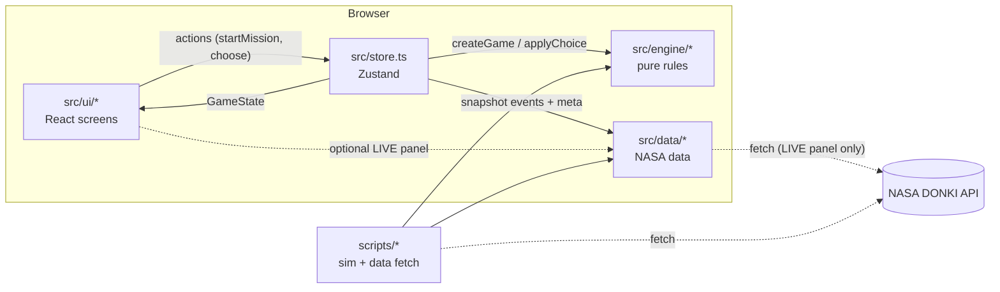
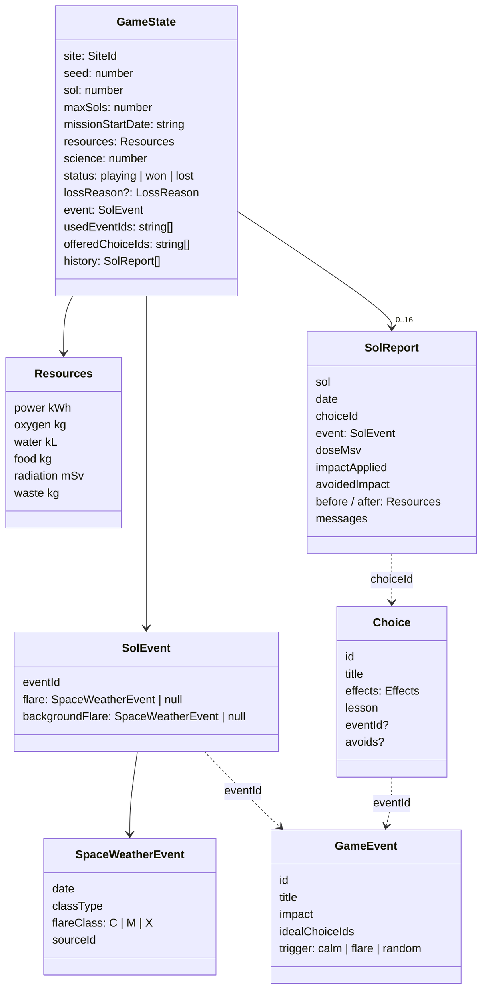
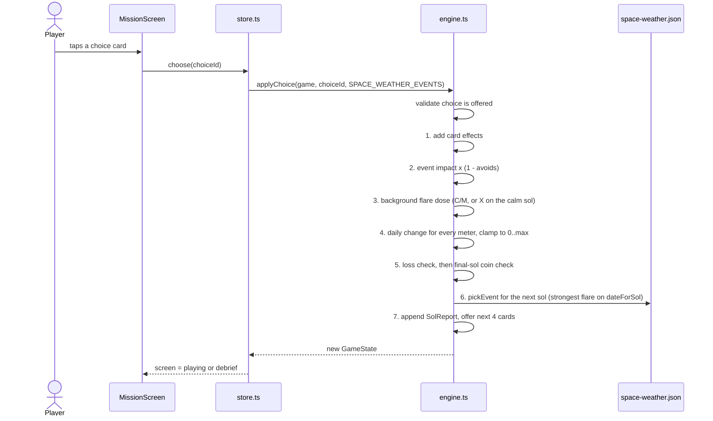
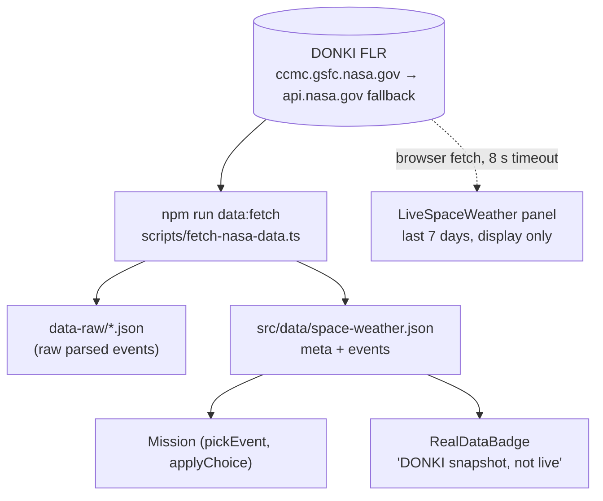
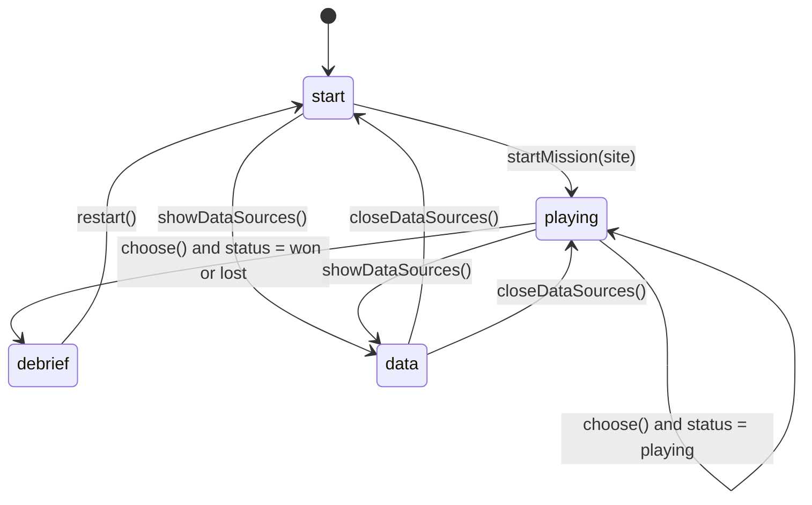

# System design

How the game is put together today: the layers, how one day (sol) flows through them, and - most importantly - **which file is the source of truth for each business rule**. Read this before changing behaviour so you edit the right file and update the right docs.

For _why_ things are this way, see `docs/decisions.md`. For the player-facing rules and formulas, see `docs/game-design.md`.

## 1. Overview

A static, client-only web app (Vite + React 19 + TypeScript strict). There is no backend and no persistence: a mission lives in memory for one browser session.

### Layer responsibilities

| Layer | Path | Owns | Must not |
| ------ | ---- | ---- | -------- |
| Engine | `src/engine/` | All game rules, tuning, the card and event catalogues, turn resolution, seeded RNG | Import React, Zustand, Framer Motion, `src/ui` or `src/store` (ESLint `no-restricted-imports`); use `Math.random` |
| Data | `src/data/` | Bundled space-weather snapshot, DONKI client and parser, source attribution, curated facts | Contain game rules; present the snapshot as live |
| Store | `src/store.ts` | Current screen, current `GameState`, wiring engine + data together, the random seed | Compute game rules itself |
| UI | `src/ui/`, `src/App.tsx` | Rendering, kid-facing labels and loss messages, accessibility | Compute game rules (read `RULES`, `METERS`, `CHOICES_BY_ID`, `EVENTS_BY_ID` and engine helpers such as `isWarning` for display only) |
| Scene | `src/scene/` | The Phaser 2D view: layout and visual config, `BaseScene`, `startScene` (lazy-loaded) | Import React, the UI or the store; call `applyChoice` / `createGame`; keep its own copy of game numbers (ESLint enforces the imports) |
| Scripts | `scripts/` | Balance simulator, snapshot refresh | Ship to the browser |

The engine being pure is what makes `npm run sim` possible: the simulator plays thousands of headless games against the exact code the UI uses.

## 2. Business-rule context files

This is the map of where each rule lives. **Code is authoritative**; the docs explain and must be kept in sync with it (`docs/game-design.md` says so explicitly). Tests and lint enforce the non-negotiable rules from `AGENTS.md`.

### 2.1 Rules in code (source of truth)

| File | Business rules it defines |
| ---- | ------------------------- |
| `src/engine/types.ts` | The domain model. The six meters (`RESOURCE_KEYS`) and their `MeterDirection`, the shape of a `Choice` (with `eventId` and `avoids` for response cards) and its `Effects` (meters in real units plus `science`), `GameEvent`, `SolEvent`, flare classes `C`/`M`/`X`, `GameState`, `SolReport` (with `impactApplied` and `avoidedImpact`), and the seven `LossReason`s (six meters plus `science`). |
| `src/engine/config.ts` | All tuning. `RULES`: 16 sols, 4 cards per sol, coin goal 100, coin-card threshold 10. `METERS`: per-meter unit, start, dial max, daily change, warning level, fail value and direction. `SITES`: Mars only, with its **[REAL]** baseline dose (0.67 mSv per sol, Curiosity RAD) and citation, used as the radiation daily change. `FLARE_DOSE_MSV`: game-scaled dose per flare class. |
| `src/engine/choices.ts` | The 13 regular cards (recovery and coin pools): effects (the trade-off), kid-readable title and description, the real-world `lesson`, and the planned scene animation. Exports `ALL_CHOICES` and `CHOICES_BY_ID`, which include the response cards. |
| `src/engine/events.ts` | The 10 events (calm, solar flare, 8 random) with their impact and two response cards, and the 18 response cards with their `avoids` share. |
| `src/engine/engine.ts` | Turn resolution and win/loss. `pickEvent` (calm first sol, X-class flare event, seeded random event without repeats), `offerChoiceIds` (2 response + 1 recovery + 1 coin), `applyChoice` (card, event impact minus the avoided share, background flare, daily change, clamping), `roomBeforeWarning` / `neediestMeter`, `isWarning` / `isFailed`, `strongestFlareOn`, `dateForSol` (sol N = start date + N-1 days), and the background-flare messages. |
| `src/engine/rng.ts` | Determinism: mulberry32 PRNG. A given seed and sol always give the same event and cards. |
| `src/data/space-weather.json` | Which calendar days have flares and how strong (the mission's real weather), plus `meta` (`source`, `verified`, `isLive: false`, `missionStartDate`). A verified DONKI snapshot, 2024-05-06 to 2024-05-21. |
| `src/data/donki.ts` | How DONKI flare records become game events: class = first letter of `classType`; A/B and unclassified flares are dropped; date = `peakTime` (fallback `beginTime`). Endpoint order: `ccmc.gsfc.nasa.gov` (no key), then api.nasa.gov. |
| `src/data/sources.ts` | Which NASA sources are credited in-game (Data Sources screen). |
| `src/data/facts.ts` | The real facts shown in the debrief, each tied to a `sourceId` and a `verified` flag. |
| `src/ui/labels.ts` | Kid-facing wording that carries teaching content: meter names, icons and tooltip explanations, `displaySol` (engine sol + 214), the Coins label, `formatAmount` (units), and `LOSS_MESSAGES` (title + lesson for every loss reason). |
| `src/store.ts` | Session rules: a new random seed per mission, the mission always runs on the bundled snapshot, screen transitions (`start` → `playing` → `debrief`, `data` overlay). |
| `src/ui/LiveSpaceWeather.tsx` | The only live network call in the browser: last 7 days of DONKI flares, display only, never fed into the mission. |

### 2.2 Rules enforced automatically

| File | What it guarantees |
| ---- | ------------------ |
| `src/engine/design-rules.test.ts` | Every regular card has a gain and a cost; every response card has a cost of its own and a gain (its own or the impact it prevents); no regular card dominates another, and neither response card to an event dominates the other; every event except the calm sol has exactly two response cards that belong to it; no event impact takes coins; at most six meters; text length limits; unique ids. **Never weaken this test to make a change pass.** |
| `src/engine/engine.test.ts` | Event picking (calm first sol, X-class flare event, background flares, no repeats, determinism), the 2 + 1 + 1 card offer, the recovery card for each meter, no Send data to Earth on discovery sols, room before warning, resolution order, the avoided share, each meter's fail value, final-sol win/loss on coins, no input after the mission ends. |
| `src/ui/labels.test.ts` | Sol 215-230 display and unit formatting. |
| `src/data/data.test.ts` | The snapshot is never labelled live, events are inside the snapshot range, every fact cites a known source, DONKI parsing. |
| `eslint.config.js` | Engine purity (no UI, state-library or Phaser imports in `src/engine/**`); scene purity (no React, UI, store, `applyChoice` or `createGame` in `src/scene/**`). |
| `tests/e2e/smoke.spec.ts` | Landing to debrief with no console errors; scene values match the dials for 3 sols; Phaser loads only after Enter and a restart leaves one canvas; dial tooltips open on hover, focus and tap; `?seed=1` replays the same events and cards. |
| `scripts/simulate.ts` | Balance (not a pass/fail test): win and loss-reason rates for random, coin-rush and balanced strategies. |

### 2.3 Rules in documentation (intent and constraints)

| File | Business context it provides |
| ---- | ---------------------------- |
| `AGENTS.md` | The non-negotiable rules (trade-offs, six meters, pure engine, no invented data, attribution, writing for 7-12) and the definition of done. Start here. |
| `docs/challenge-brief.md` | The NASA Space Apps challenge text and judging signals: the external requirements everything else serves. |
| `docs/game-design.md` | The core loop, the resolution order, meter and event tables, win/loss, where the game simplifies reality, and balance targets with current sim results. |
| `docs/data-sources.md` | Every data source with endpoints, fields used, real values and citations; each number tagged REAL, CURATED or GAME. |
| `docs/content-guidelines.md` | Reading level, tone (losses are learning moments), honesty about "real", accessibility (48 px targets, never colour alone, keyboard, screen readers, 375 px layout). |
| `docs/glossary.md` | Space terms and the exact kid-friendly wording to use for each. |
| `docs/decisions.md` | Why the rules are what they are (six meters and event-first sols, DONKI via CCMC, the game-scaled dose budget, snapshot-not-live, React + pure engine). |
| `.cursor/plans/new_game_layout_4b40858c.plan.md` | The single checklist for remaining work (Phases 0-6); `docs/roadmap-2d.md` points to it. |

### 2.4 Which file to change

| You want to... | Change | Then update / run |
| -------------- | ------ | ----------------- |
| Retune numbers (meters, goal, flare dose, impacts) | `src/engine/config.ts`, `src/engine/events.ts` | `npm run sim`; `docs/game-design.md` (tables and balance results) |
| Add or edit a regular card | `src/engine/choices.ts` | `npm run check` (design rules); `npm run sim`; `docs/glossary.md` for new words |
| Add or edit an event or response card | `src/engine/events.ts` | `npm run check`; `npm run sim`; `docs/game-design.md` event table |
| Change how a sol resolves, how events are picked or how cards are offered | `src/engine/engine.ts` | `engine.test.ts`; `docs/game-design.md` core loop; `npm run sim`; `docs/decisions.md` |
| Add a meter or loss reason | `types.ts`, `config.ts`, `ui/labels.ts` | Requires a `docs/decisions.md` entry (the six-meter cap is a design rule) |
| Add a site | `SiteId` in `types.ts`, `SITES` in `config.ts` | Real baseline dose with citation in `docs/data-sources.md` and `src/data/sources.ts` |
| Refresh or change space-weather data | `npm run data:fetch` (writes `space-weather.json`) | `npm run sim`; `docs/data-sources.md` status |
| Add a NASA source or fact | `src/data/sources.ts`, `src/data/facts.ts` | `docs/data-sources.md` |
| Change kid-facing wording | `choices.ts`, `events.ts`, `ui/labels.ts`, UI components | `docs/content-guidelines.md` checklist |

## 3. Domain model

`GameState` is immutable: every engine function returns a new object. `history` doubles as the mission log and the debrief input.

## 4. Turn resolution

Key rules (values from `config.ts`):

- Avoided share: `avoidedImpact = impact x avoids` (rounded to 0.01), and `impactApplied = impact - avoidedImpact`, so the two always add up to the full impact.
- Loss: power, oxygen, water or food ≤ 0; radiation ≥ 40 mSv; waste ≥ 300 kg. Checked before the win check, so you cannot win on a sol you lose.
- Win: still going at the end of sol 16 (Sol 230) with coins ≥ 100; otherwise the loss reason is `science`.

### Event and card offering

`pickEvent` decides the sol's event before the cards: calm on sol 1; Solar Flare on a date with a real X-class flare; otherwise a random event seeded by `seed x 7919 + sol`, chosen from the events not yet used (the pool refills once all eight have appeared).

`offerChoiceIds` seeds its RNG with `seed x 1000 + sol` and builds four cards:

1. The event's **two response cards**.
2. One **recovery** card that helps the meter with the least room before its warning level - so a careful player never loses purely to bad luck.
3. One **coin** card (10 or more coins) - so every sol asks "safety or science?" On a discovery sol, Send data to Earth is excluded.
4. On the calm first sol, two more regular cards replace the response cards. The four are shuffled.

## 5. Data pipeline

- The mission **always** uses the bundled snapshot so play is reproducible and works offline. `meta.isLive` is always `false` (tested).
- `missionStartDate` in the snapshot sets the calendar date of sol 1 (Sol 215 = 2024-05-06), which is how real flare dates line up with sols.
- The LIVE panel uses `VITE_NASA_API_KEY` (falls back to `DEMO_KEY`) and shows "unavailable" on any failure; it never affects game state. Vite embeds `VITE_` variables in the build, so that key is public once deployed.
- Values are labelled by trust level: **REAL** (the Mars baseline, DONKI flare dates and classes), **GAME** (everything else in `config.ts` and `events.ts`, including the meter amounts, which use real units).

## 6. UI and screen flow

| Component | Role |
| --------- | ---- |
| `LandingScreen` | Star field, Earth, Mars, rocket flight (Framer Motion, Skip, reduced motion jumps to the end), welcome text, Enter, `RealDataBadge`, `LiveSpaceWeather` |
| `MissionScreen` | A full-width outpost picture (NASA artist's concept PIA23302, captioned as a drawing) with the transparent `PhaserGame` layer and `StatusBar` on top; then `EventsPanel`, four `ChoiceCard`s and `MissionLog` |
| `StatusBar` | Overlaid on the picture, the only place meters appear: six `ResourceGauge`s, `CoinCounter` (a growing pile of SVG gold coins), `SolCounter` (Sol 215-230 and the Earth date) |
| `EventsPanel` | Today's event with the real flare label, the unhandled impact, yesterday's result, `aria-live` |
| `ResourceGauge` | Icon, value with unit and a segmented fill bar with a striped danger zone; `role="meter"`, ⚠️ plus "Low!" / "Too high!"; the tooltip opens on hover, focus and tap and is linked with `aria-describedby` |
| `Coin` | `CoinIcon` (a front-facing gold coin) and `CoinStack` (one coin per tenth of the goal), used for coins everywhere |
| `PhaserGame` | The bridge: lazy-loads `src/scene`, creates one transparent Phaser game (2:1, `Scale.ENVELOP`, aligned with the picture's `object-cover`), pushes each new `GameState` into it, destroys it on unmount, publishes the `?e2e` snapshot (`testHook.ts`) |
| `ChoiceCard` | One card with `+`/`−` effect chips in real units (never colour alone) and a "Handles: ... stops all / half of it" tag on response cards |
| `DebriefScreen` | Win/loss title and lesson (`LOSS_MESSAGES`), coins, radiation, days with real flares, the lesson of every card used, one real fact (`FACTS[seed % length]`) with its source, mission log |
| `DataSourcesScreen` | Attribution for every source in `DATA_SOURCES` |

## 7. Determinism, testing and quality gates

- **Determinism:** all randomness inside the engine goes through `rng.ts`. The only non-deterministic input is the seed chosen in `store.ts` (`Math.random`), which keeps the engine replayable from `(seed, site, snapshot)`.
- **`npm run check`:** typecheck + lint (engine purity) + unit tests (design rules, engine, labels, data). Required before calling work done.
- **`npm run sim`:** required after any tuning change; the balanced strategy must win clearly more often than random and coin-rush (targets in `docs/game-design.md`).
- **`npm run test:e2e`:** one Playwright smoke test of the full happy path.

## 8. Known gaps

- The Mars baseline and facts are marked "TODO verify" / `verified: false` in `docs/data-sources.md` and `facts.ts` (Phase 5).
- `api.nasa.gov/DONKI/FLR` returns 404, so it is only the fallback; every DONKI call currently uses CCMC.
- Food and oxygen reach their warning levels but almost never end a mission (see `docs/game-design.md`).
- No persistence (refresh loses the mission) and no difficulty levels yet.
- The scene shows values but no animations yet (Phase 2 cues). At 375 px its labels are small and the cards start below the first screen (P3.5).
- The Phaser chunk is 321 kB gzip; it loads only after Enter.